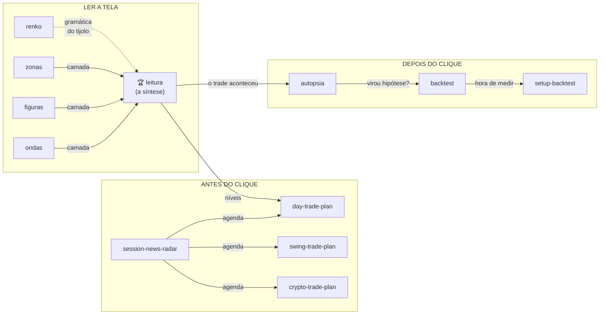

<p align="center">
  <picture>
    <source media="(prefers-color-scheme: dark)" srcset=".github/assets/lockup-dark.png">
    
  </picture>
</p>

<h1 align="center">AEGIS SKILLS</h1>

<p align="center"><b>Análise de mercado com IA que não mente pra você.</b></p>

<p align="center">
  
  
  
  
</p>

---

Doze skills de Claude para trading, em duas famílias: **7 de leitura de tela** (você cola o
print, recebe estrutura) e **5 de plano e validação** (o trabalho que acontece **antes** e **depois** do
clique, planejar, checar a agenda, dimensionar, validar). Todas com a honestidade embutida
na engenharia:

- **Nenhuma dá call.** Análise sai em cenários *se/então* com **nível de invalidação**; plano
  sai com stop, tamanho calculado e o que mata a tese, o formato que trader de verdade usa.
- **Nenhuma inventa número.** Sem preço no print ou na conversa? A skill deixa **placeholder
  nomeado** pra você preencher e avisa, em vez de fabricar um nível.
- **Nenhuma finge ver o mercado.** Claude não tem cotação em tempo real: as skills analisam
  o que **você** cola e o que dá pra verificar na web. Quem te vende "IA que opera sozinha"
  está te vendendo o guru de sempre com casca nova.

## As 5 de plano e validação: antes e depois do clique

O trabalho fora do gráfico, onde o day trade é ganho ou perdido:

| # | Skill | O que faz | Dispara com |
|---|-------|-----------|-------------|
| 1 | **[Day Trade Plan](day-trade-plan/)** | Plano do dia: contexto, agenda em BRT, níveis com origem, **3 cenários sempre** (alta/baixa/lateral) com R e contratos calculados, regras do dia, checklist pré-entrada | *"plano pra amanhã no WIN"*, *"mudou algo?"* |
| 2 | **[Session News Radar](session-news-radar/)** | Busca e classifica as notícias/eventos de impacto **pro seu ativo** numa sessão, com sensibilidade por lado e janelas de risco | *"o que tem hoje pro dólar?"*, *"por que o BTC tá caindo?"* |
| 3 | **[Swing Trade Plan](swing-trade-plan/)** | Plano de dias a semanas: tese em uma frase, catalisadores com data, stop estrutural, **invalidação separada do stop**, gestão, custos de carregar | *"swing em PETR4"*, *"estou carregando X, e agora?"* |
| 4 | **[Crypto Trade Plan](crypto-trade-plan/)** | A camada que só existe em cripto: funding, OI, liquidações, fim de semana, com **calculadora de tamanho e preço de liquidação** | *"estou long 10x em BTC"*, *"vale entrar em ETH?"* |
| 5 | **[Setup Backtest](setup-backtest/)** | Os números do teste: lê a planilha ou o CSV de trades (até print de planilha), calcula métricas em R, **Monte Carlo** e dentro × fora da amostra, e dá o veredito go/no-go contra o critério escrito antes. O desenho do método fica com a Backtest Honesto | *"analisa minha planilha"*, *"posso aumentar a mão?"* |

**Como foram testadas:** cada uma rodou num cenário real (agenda de verdade, preço buscado na
web, planilha de 64 trades), com e sem a skill, contra critérios de qualidade escritos antes.
Com skill: **93%** dos critérios atendidos; sem: **61%**. O que a skill mais adiciona não é
"saber mais", é **disciplina de formato**: três cenários sempre, R calculado e não estimado,
invalidação separada do stop, critério de aprovação escrito antes do resultado.

## As 7 de leitura de tela: print → estrutura

| # | Skill | O que faz |
|---|-------|-----------|
| 1 | **[Leitura de Gráfico](leitura/)** 🏆 | A carro-chefe. Modo **ANTES** (print → estrutura, zonas, cenários com invalidação) e modo **DEPOIS** (print do desfecho → a leitura é cobrada, o **processo** é julgado e a lição extraída). O ciclo que treina o olho. |
| 2 | **[Ondas de Elliott](ondas/)** | Contagem no print com as 3 regras duras conferidas, contagem **alternativa obrigatória** e cenários com invalidação. |
| 3 | **[Figuras de Candle](figuras/)** | Identifica os padrões e julga cada um pelo **contexto**, figura em zona importa, figura no meio do nada é ruído. |
| 4 | **[Zonas de Suporte e Resistência](zonas/)** | Mapa de S/R como **zonas** (bandas, nunca linhas), com toques, força, frescor e flip de papel. Máximo 6, mapa poluído é mapa inútil. |
| 5 | **[Leitura Renko](renko/)** | A gramática própria do tijolo: sequências, zonas por **flips**, caixas de congestão, rompimento medido em tijolos e crítica da calibração. |
| 6 | **[Autópsia de Trade](autopsia/)** | O trade na mesa: linha do tempo comentada, erro de **leitura × disciplina × execução × variância**, erro-raiz único e UMA lição portátil. |
| 7 | **[Backtest Honesto](backtest/)** | **PROJETAR** (da ideia ao protocolo testável) e **AUDITAR** (o ataque: overfitting, janela a dedo, look-ahead, amostra pequena). |

## Como o pacote se encaixa



O `session-news-radar` alimenta os três planos com a agenda; a `leitura` dá os níveis que o
plano do dia usa; `autopsia` transforma o trade em hipótese e `backtest`/`setup-backtest`
transformam a hipótese em número. É a mesa inteira de uma operação, sem ninguém dando call.

## Instalação

Cada skill é uma pasta com um `SKILL.md` (algumas trazem também `references/` e scripts).
Três caminhos:

### Claude (claude.ai / app): planos pagos
1. Baixe os `.zip` prontos na **[página de Releases](../../releases)**, pelo computador. **Não descompacte.**
2. Em claude.ai: **Settings → Capabilities**. Ligue **Code execution and file creation** (as skills dependem disso).
3. Na mesma tela, em **Skills → Upload skill**, envie um ZIP por vez. Depois é só conversar: a skill dispara sozinha quando o pedido combina com ela.

> Os ZIPs da v1.x saíram com caminho em barra invertida e não abriam no Mac, no iPhone nem no upload do claude.ai. Desde a v2.0 eles são gerados por `tools/empacotar.mjs`, que valida cada skill e confere o ZIP lendo de volta. Baixou antes de 07/11/2026? Baixe de novo.

### Sem Claude pago (Claude grátis, ChatGPT, Gemini, Grok)
Cada release traz a **versão para colar** de cada skill (`<nome>.txt`): copie da linha `INÍCIO` até a linha `FIM` e cole como primeira mensagem de uma conversa nova, ou nas instruções de um Projeto (Claude), GPT (ChatGPT) ou Gem (Gemini).

### Claude Code (terminal / desktop)
```bash
git clone https://github.com/aaegisengine/aegis-skills.git
cp -r aegis-skills/{leitura,ondas,figuras,zonas,renko,autopsia,backtest,day-trade-plan,session-news-radar,swing-trade-plan,crypto-trade-plan,setup-backtest} ~/.claude/skills/
```
Pronto, sem restart. Se quiser forçar uma, cite o nome: *"use a day-trade-plan pra montar o plano de amanhã"*.

### Gerar os pacotes
```bash
node tools/empacotar.mjs           # valida as 12 e gera _dist/v2/ (zips, versões para colar e .docx)
node tools/empacotar.mjs --checar  # só valida
```

## Como tirar um print que a IA lê bem

Vale pras 7 de leitura de tela, a qualidade da análise depende da qualidade do print:

- ✅ **Eixo de preço visível e legível**, sem ele a skill lê estrutura, mas não crava nível (e te avisa)
- ✅ **Gráfico limpo**, o mínimo de indicador em cima do preço
- ✅ **Histórico suficiente**, ~100 candles/tijolos na tela; print de 15 candles não tem estrutura
- ✅ **Print direto da plataforma**, melhor que foto da tela com o celular
- ✅ **Ativo e timeframe no título** aparecendo, ajuda, não obriga

## O que este pacote NÃO é

> **Não é sinal.** Nenhuma skill diz compra/venda. Elas dizem *"se X, então a estrutura espera
> Y, e morre se Z"*. A decisão é sua, sempre foi.
>
> **Não é IA que opera sozinha.** Claude não enxerga o mercado em tempo real; as skills
> trabalham com o que você cola e com o que dá pra verificar.
>
> **Não é promessa.** Análise educacional de estrutura gráfica e de processo.
> **Não é recomendação de investimento.**

## Licença

[CC BY-NC 4.0](LICENSE.md), uso pessoal livre com atribuição; **uso comercial proibido**
(ninguém revende o que é seu de graça).

---

<p align="center"><b>AEGIS ENGINE</b> · disciplina &gt; sinal · <a href="https://www.instagram.com/aegisengine/">@aegisengine</a></p>
