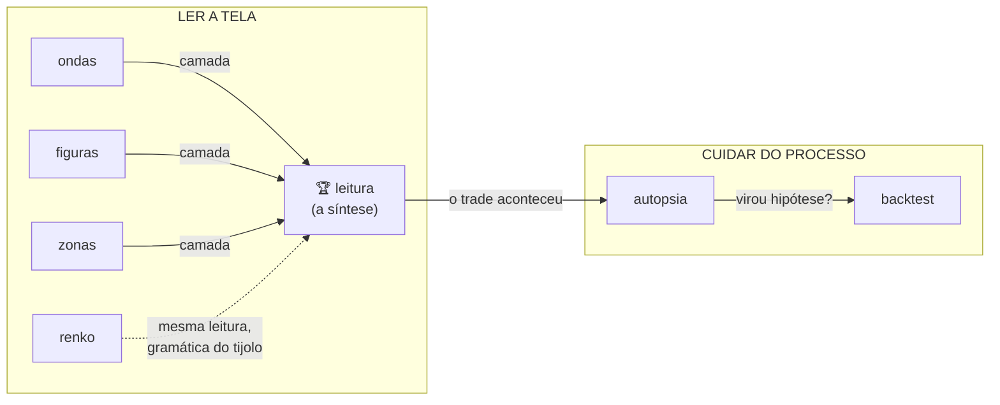

<p align="center">
  <picture>
    <source media="(prefers-color-scheme: dark)" srcset=".github/assets/lockup-dark.png">
    
  </picture>
</p>

<h1 align="center">AEGIS SKILLS</h1>

<p align="center"><b>Análise de mercado com IA que não mente pra você.</b></p>

<p align="center">
  
  
  
  
</p>

---

Sete skills de Claude para **análise de gráfico e processo de trading**. Você cola o print —
qualquer ativo, qualquer timeframe — e recebe leitura de estrutura com a honestidade embutida
na engenharia:

- **Nenhuma dá call.** Toda análise sai em cenários *se/então* com **nível de invalidação** —
  o formato que trader de verdade usa.
- **Nenhuma inventa número.** Eixo de preço ilegível no print? A skill analisa a estrutura e
  **avisa** que não crava nível, em vez de fabricar um.
- **Nenhuma finge ver o mercado.** Claude não tem cotação em tempo real — as skills analisam
  o que **você** cola. Quem te vende "IA que opera sozinha" está te vendendo o guru de sempre
  com casca nova.

## As 7 skills

| # | Skill | O que faz |
|---|-------|-----------|
| 1 | **[Leitura de Gráfico](leitura/)** 🏆 | A carro-chefe. Modo **ANTES** (print → estrutura, zonas, cenários com invalidação) e modo **DEPOIS** (print do desfecho → a leitura é cobrada, o **processo** é julgado e a lição extraída). O ciclo que treina o olho. |
| 2 | **[Ondas de Elliott](ondas/)** | Contagem no print com as 3 regras duras conferidas, contagem **alternativa obrigatória** e cenários com invalidação. |
| 3 | **[Figuras de Candle](figuras/)** | Identifica os padrões e julga cada um pelo **contexto** — figura em zona importa, figura no meio do nada é ruído. |
| 4 | **[Zonas de Suporte e Resistência](zonas/)** | Mapa de S/R como **zonas** (bandas, nunca linhas), com toques, força, frescor e flip de papel. Máximo 6 — mapa poluído é mapa inútil. |
| 5 | **[Leitura Renko](renko/)** | A gramática própria do tijolo: sequências, zonas por **flips**, caixas de congestão, rompimento medido em tijolos e crítica da calibração. |
| 6 | **[Autópsia de Trade](autopsia/)** | O trade na mesa: linha do tempo comentada, erro de **leitura × disciplina × execução × variância**, erro-raiz único e UMA lição portátil. |
| 7 | **[Backtest Honesto](backtest/)** | **PROJETAR** (da ideia ao protocolo testável) e **AUDITAR** (o ataque: overfitting, janela a dedo, look-ahead, amostra pequena). |

## Como o pacote se encaixa



`ondas`, `figuras` e `zonas` são as três camadas que a `leitura` usa por dentro — ela faz a
síntese, elas fazem o mergulho. `renko` é a mesma leitura traduzida pra gramática do tijolo.
`autopsia` e `backtest` cuidam do que acontece **fora** do gráfico: o processo.

## Instalação

Cada skill é uma pasta com um `SKILL.md`. Dois caminhos:

### Claude (claude.ai / app) — planos pagos
1. Baixe os `.zip` prontos na **[página de Releases](../../releases)** (ou compacte a pasta da skill).
2. Em claude.ai: **Settings → Capabilities → Skills → Upload skill** e envie o ZIP.
3. Repita por skill. Depois é só colar o print no chat e pedir — a skill dispara sozinha.

### Claude Code (terminal / desktop)
```bash
git clone https://github.com/aaegisengine/aegis-skills.git
cp -r aegis-skills/{leitura,ondas,figuras,zonas,renko,autopsia,backtest} ~/.claude/skills/
```
Pronto — sem restart. Cole o print e peça a análise.

## Como tirar um print que a IA lê bem

A qualidade da análise depende da qualidade do print:

- ✅ **Eixo de preço visível e legível** — sem ele a skill lê estrutura, mas não crava nível (e te avisa)
- ✅ **Gráfico limpo** — o mínimo de indicador em cima do preço
- ✅ **Histórico suficiente** — ~100 candles/tijolos na tela; print de 15 candles não tem estrutura
- ✅ **Print direto da plataforma** — melhor que foto da tela com o celular
- ✅ **Ativo e timeframe no título** aparecendo — ajuda, não obriga

## O que este pacote NÃO é

> **Não é sinal.** Nenhuma skill diz compra/venda. Elas dizem *"se X, então a estrutura espera
> Y — e morre se Z"*. A decisão é sua, sempre foi.
>
> **Não é promessa.** Análise educacional de estrutura gráfica e de processo.
> **Não é recomendação de investimento.**

## Licença

[CC BY-NC 4.0](LICENSE.md) — uso pessoal livre com atribuição; **uso comercial proibido**
(ninguém revende o que é seu de graça).

---

<p align="center"><b>AEGIS ENGINE</b> · disciplina &gt; sinal · <a href="https://www.instagram.com/aegisengine/">@aegisengine</a></p>
